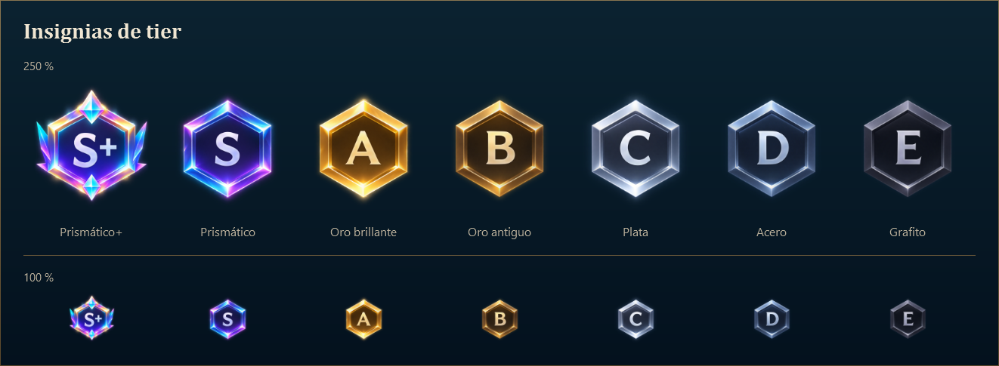
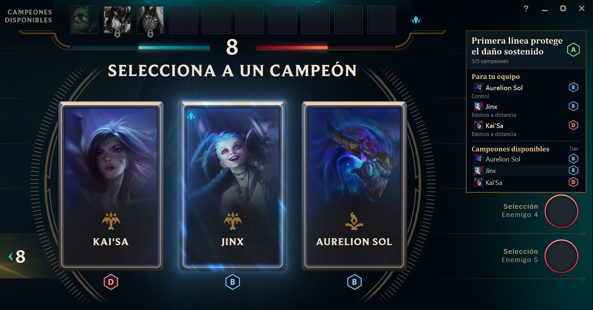
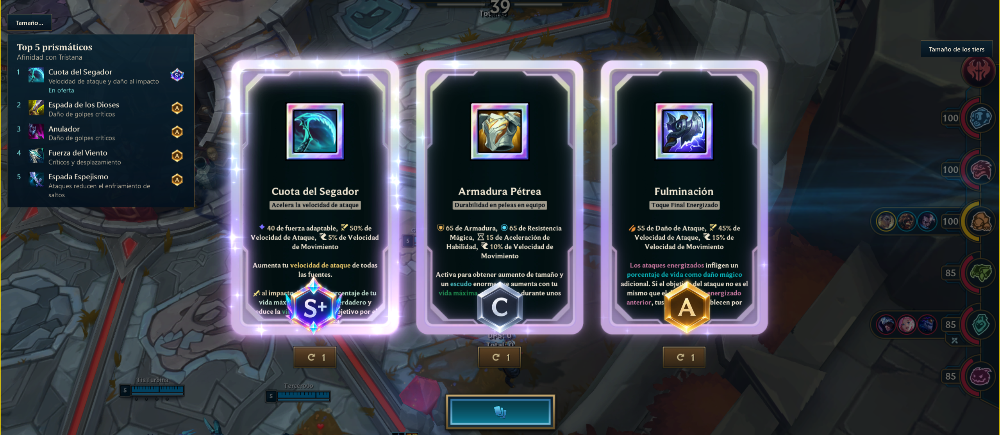
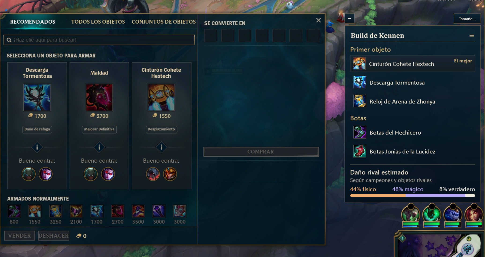
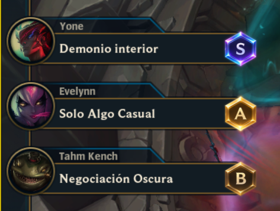

# Capturas de los overlays

**Parche 26.23 · Actualizado el 25 de noviembre de 2026.** Las ofertas y tiendas se reprodujeron con capturas de League, las tablas del parche y equipos e inventarios de ejemplo. El trío de Zyra, Olaf y Dr. Mundo se reprodujo con el registro de selección del cliente. Los tiers en partida están al **250 %**, el ajuste de tiers en selección de campeón al **200 %**, las builds al **150 %** y el panel de prismáticos al **150 %**. En este equipo se usaron Cambria y Segoe UI.

| Selección de campeón en ARAM Caos | Top 5 prismáticos en Arena |
| --- | --- |
|  |  |
| **Build junto a la tienda en ARAM Caos** | **Invitados de Honor en Arena** |
|  |  |

## Selección de campeón

| Modo | Capturas |
| --- | --- |
| ARAM Caos | [Oferta de tres campeones y sugerencias para el equipo](aram-seleccion-tres-cartas.png) · [Oferta de dos con una carta ampliada](aram-seleccion-dos-cartas.png) |
| ARAM Caos | [Banco con tiers centrados en el borde inferior de los retratos](aram-seleccion-banco.png) · [Hechizos principales y alternativos de Gragas](aram-hechizos.png) |
| Arena | [Composición, estado de cada elección, sugerencias y Top 30 completo](arena-seleccion-top-30.png) · [Zyra, Olaf y Dr. Mundo confirmados](arena-seleccion-equipo-completo.png) |

## Tiers en partida

| Vista | ARAM Caos | Arena |
| --- | --- | --- |
| Aumentos | [Cuatro cartas](aram-aumentos-cuatro.png) · [Tres cartas, una sin tier](aram-aumentos-tres.png) | [Tres aumentos](arena-aumentos.png) · [Mejoras de nivel](arena-mejoras.png) |
| Yunque de estadísticas | [Tiers de los fragmentos](aram-fragmentos-yunque.png) | [Tiers de los fragmentos](arena-fragmentos-yunque.png) |
| Ofertas de objetos | — | [Legendarios con Rell](arena-legendarios.png) · [Legendarios con Zyra](arena-legendarios-zyra.png) · [Prismáticos con tier sobre cada carta y Top 5 al lado](arena-prismaticos-top-5.png) |
| Invitados de Honor | — | [Tres opciones de voto con tiers ampliados junto al título](arena-invitados-de-honor.png) |

## Builds y tienda

| Vista | ARAM Caos | Arena |
| --- | --- | --- |
| Compras | [Objetos iniciales](aram-build-inicial.png) · [Compra prioritaria junto a la tienda](aram-build-tienda.png) · [Ruta local](aram-build-ruta-local.png) | [Build de Swain con prismáticos y daño estimado de los rivales y del lobby](arena-build-tienda.png) |
| Posición y visibilidad | [Panel plegado y botón para abrirlo](aram-build-plegada.png) | [Panel de Jax arrastrado a la izquierda de la tienda](arena-build-movida.png) |
| Inventario lleno | [Build completa](aram-build-completa.png) · [Cambio sugerido para Zilean](aram-build-cambio.png) | [Cambio sugerido para Jinx](arena-build-cambio.png) |

Cuando el cliente aún no identifica al campeón, ambos modos muestran el mismo aviso. [Ver el aviso de la tienda](build-sin-campeon.png)

## Ajustes de tamaño

| Elemento | Control en partida | Vista previa desde la bandeja |
| --- | --- | --- |
| Tiers de cartas | [Deslizador junto a la oferta](ajuste-tiers.png) | [Tamaño de los tiers de cartas](bandeja-tamano-tiers.png) |
| Tiers al seleccionar campeón | [Insignias de los retratos del banco](aram-seleccion-banco.png) | [Tamaño de los tiers de campeones](bandeja-tamano-tiers-campeones.png) |
| Builds | [Deslizador sobre la build](ajuste-build.png) | [Tamaño de las builds](bandeja-tamano-build.png) |
| Top 5 prismáticos | [Deslizador sobre el Top 5](ajuste-prismaticos.png) | [Tamaño del panel de prismáticos](bandeja-tamano-prismaticos.png) |

La ventana de diagnóstico comparte el marco y la paleta de los ajustes. [Ver el diagnóstico](diagnostico.png)
